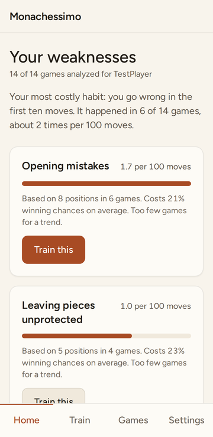
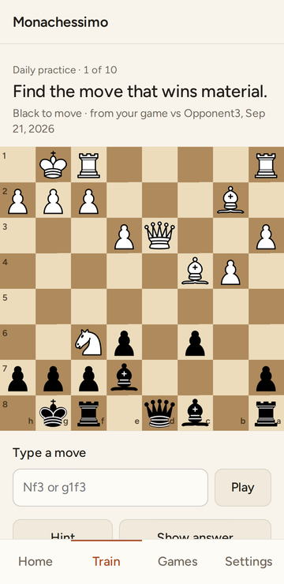
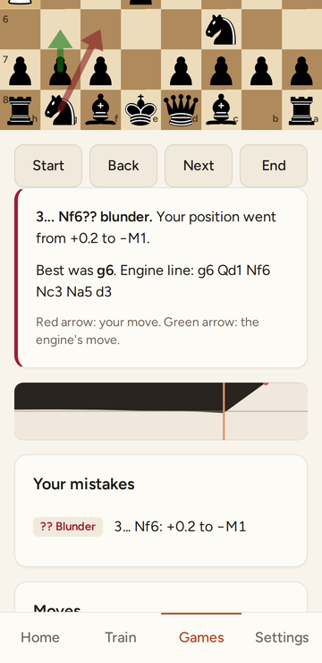
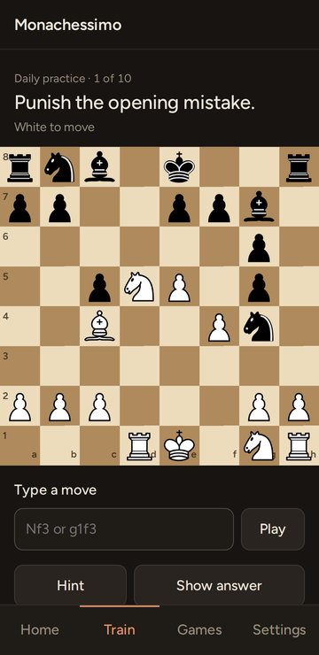

# Monachessimo

Monachessimo is a free chess trainer that runs in your browser. You enter a Lichess or Chess.com username. The app imports your games, runs Stockfish on your own device, finds the mistakes you repeat, and builds practice from them.

Live site: https://multi-volt.github.io/Monachessimo/

<p>
  
  
  
  
</p>

The screenshots use generated test games.

## Status

The app is feature-complete for a first release: import, on-device analysis, the weakness profile, drills from your games, theme puzzles, offense and strategy drills, offline use, and the polish pass. Testing on real phones is still to do. See `docs/DECISIONS.md`.

To contribute, read [AGENTS.md](AGENTS.md).

## Privacy

Your games, analysis, and practice history stay in your browser's storage on your device. The app sends requests only to Lichess and Chess.com, and only to fetch your public games. It has no accounts, no cookies, and no analytics.

## Development

You need Node.js 22.12 or newer. CI uses Node 26.

```sh
npm install
npm run dev          # local dev server
npm test             # unit tests (Vitest)
npm run lint         # ESLint
npm run typecheck    # TypeScript, strict mode
npm run build        # typecheck, then production build into dist/
npm run test:e2e     # Playwright at a 360x740 phone viewport, against the build
```

Before the first `npm run test:e2e`, run `npx playwright install chromium`.

Theme puzzles come from the Lichess puzzle database, released under CC0. To build the puzzle files locally, run:

```sh
node scripts/build-puzzle-shards.ts            # downloads 310 MB, writes public/puzzles/
```

Without them the app works and skips theme puzzles.

To build for GitHub Pages locally, set the base path to the repository name:

```sh
BASE_PATH=/Monachessimo/ npm run build
```

## Offline use

After the first visit the site works without a connection: the app, the engine and any puzzles you have opened are cached by a service worker. On Android Chrome you can install it from Settings. On iPhone and iPad, open it in Safari, tap Share, then Add to Home Screen.

The site also offers a single-file copy at `offline/monachessimo.html`. It is about 3 MB and holds the engine and a small starter set of puzzles. Browsers limit what a page opened straight from a file can do, so serve it locally:

```sh
mkdir monachessimo && cd monachessimo
# put monachessimo.html here, then:
python3 -m http.server 8000
# open http://localhost:8000/monachessimo.html
```

Opening the file directly may work in some desktop browsers. On iOS, local files are best effort and may not work at all. To build the copy yourself, run `npm run build:offline`; it writes `dist-offline/index.html`.

## Deployment

Every push to `main` runs `.github/workflows/ci.yml`. The workflow checks formatting, lint, types, and unit tests, builds the site, fails if any shipped file is over 25 MiB, runs the Playwright test, and then deploys `dist/` to GitHub Pages.

The repository's Pages source must be set to GitHub Actions under Settings, Pages, Build and deployment.

## License

Monachessimo is free software under the GNU General Public License, version 3 or later. See [LICENSE](LICENSE). Third-party code and credits are listed in [THIRD_PARTY.md](THIRD_PARTY.md).
